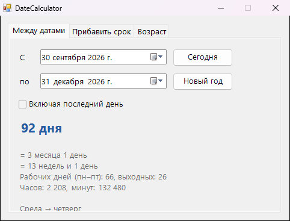

<div align="center">

# 📅 DateCalculator

**Сколько дней между датами, какая дата будет через 90 рабочих дней и сколько тебе лет с точностью до дня**




</div>

## ✨ Возможности

- 📆 **Между датами**: дни, недели, месяцы и годы, рабочие и выходные дни, часы и минуты
- ➕ **Прибавить срок**: плюс или минус N календарных или рабочих дней, недель, месяцев, лет
- 🎂 **Возраст**: точный возраст, сколько дней прожито, сколько осталось до дня рождения, в какой день недели ты родился и когда будет 10 000-й день жизни
- ✅ Правильные окончания: «1 день», «2 дня», «5 дней», «21 день»
- 🧠 Честно считает короткие месяцы и високосные годы

## 💡 Когда пригодится

- Сколько дней до отпуска, свадьбы или Нового года
- Срок по договору: «в течение 30 рабочих дней с даты подписания»
- Сколько дней прошло с начала отношений, работы или отказа от курения

## 📥 Установка

1. Скачай `DateCalculator.exe` из раздела [**Releases**](../../releases/latest)
2. Запусти его, установка не нужна

## 🛠️ Сборка из исходников

Нужен только Windows: компилятор C# входит в состав .NET Framework.

```bat
build.bat
```

## 📄 Лицензия

[MIT](LICENSE)
